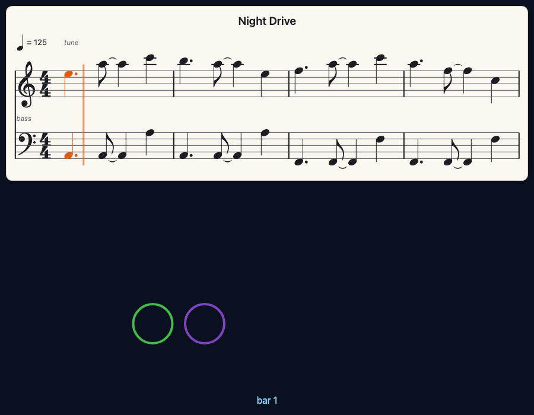
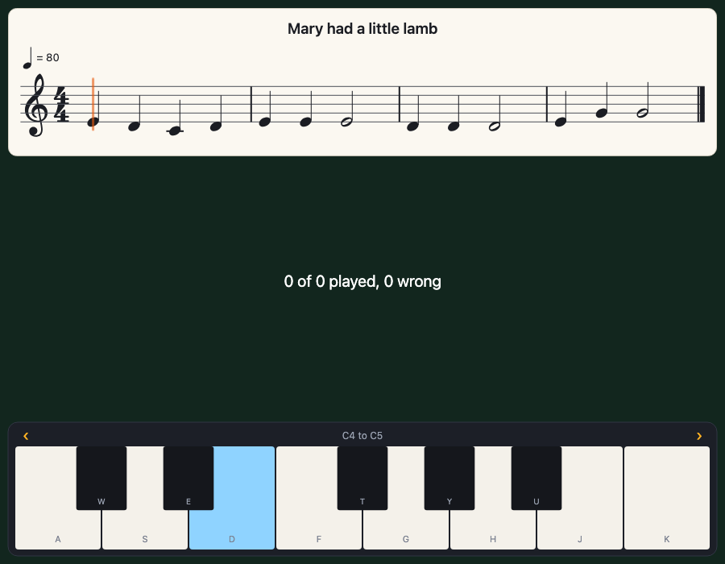

# staves

[](LICENSE)



staves writes music out as notes on a staff in a [Pyctures](https://github.com/johnwylie70/pyctures) scene, and lights the notes as they play. It is for any age and any level: you give it a tune in one line and sheet music appears; you play the tune and each note lights as it sounds; you can play along on a keyboard and it tells you how you did. It is the Python sibling of [staves.js](../staves.js), and goes with [synths](https://github.com/johnwylie70/synths-py) for sound and [pydials](https://github.com/johnwylie70/pydials) for a keyboard on the screen.

## Start with four small scenes

Each one is a whole program. Run one with `pyctures run scene.py`.

**1. A tune, written out.**

```python
from pyctures import *
from staves import *

show_notes("E4 D4 C4 D4 E4 E4 E4:2", "quarter", title="Mary had a little lamb")

def draw():
    background("midnightblue")
```

The notes are written the way `play_notes` takes them: a note is a letter and a number (`"C4"` is middle C, `"F#3"`, `"Bb5"`), `-` is a rest, `:2` makes a note last two steps, and `"quarter"` says how long a step is. The key, the clef and the bars are worked out for you.

**2. Play it, and watch it go.**

```python
from pyctures import *
from synths import *
from staves import *

page = show_notes("C4 C4 G4 G4 A4 A4 G4:2 F4 F4 E4 E4 D4 D4 C4:2", "quarter", tempo=100)
page.on_note = lambda note: print("now playing", note.name)

def on_mouse_down(x, y):
    page.play()

def draw():
    background("midnightblue")
    text("Click here to play", width / 2, height - 30, "white", 18, "centre")
```

`page.play()` plays the music through `synths` and follows it: the notes that are sounding turn orange, a line moves through the bar, and the page turns when the music reaches the next line. `page.on_note` is called as each note begins. `page.stop()` stops it.

**3. Follow a song.**

```python
from pyctures import *
from synths import *
from staves import *

song = play_song("songs/night_drive.json")
show_notes("songs/night_drive.json", channels=[3, 1], follow=song)     # the tune and the bass, a staff each

def draw():
    background("#0b1020")
```

A tracker song is turned into written music: you choose which channels to show. As the song plays, the page follows it. Tap a bar and the song jumps there. That is the picture at the top of this page.

**4. Play along.**

```python
from pyctures import *
from synths import *
from pydials import *
from staves import *

lead = make_synth("keys")
page = show_notes("E4 D4 C4 D4 E4 E4 E4:2", "quarter")
page.play_along("wait", synth=lead)
keyboard(page, octave=4, octaves=1)        # a pydials keyboard plays the page

def draw():
    background("#12261e")
    text("%d right, %d wrong" % (page.result.right, page.result.wrong), width / 2, height / 2, "white", 20, "centre")
```



The line waits at each note until you play it. The key to press is lit. A right note turns green; a wrong one shows in red for a moment where you played it. `"time"` in place of `"wait"` keeps going at the tempo whether you are ready or not.

The scenes in [examples/](examples) are ready to run: [twinkle.py](examples/twinkle.py), [song.py](examples/song.py) and [play_along.py](examples/play_along.py).

## What you can show

| You give | It is |
|---|---|
| `show_notes("C4 E4 G4 - C5:2", "quarter")` | a tune as text: notes, `-` for a rest, `:2` for two steps, `:q` `:h` `:e` `:s` `:w` for a length by name, `C4+E4+G4` or `Cm7` for a chord |
| `show_notes(["C4", None, ["C4", "E4"]], "quarter")` | the same as a list: `None` is a rest, a list inside is a chord |
| `show_notes(sheet)` | a sheet you write a note at a time: `sheet = make_sheet(key="G", time="3/4")`, then `sheet.add("G4", "quarter")`, `sheet.add(["B4", "D5"], "half")`, `sheet.rest("quarter")` |
| `show_notes("songs/tune.json", channels=[0, 1])` | a tracker song beside the scene, or the song as a dictionary, or the packed bytes of a MOD or XM |
| `show_notes([{"note": "C4", "start": 0, "length": 1}])` | plain data, in beats |

The options are those of [staves.js](../staves.js#options), spelled Python's way: `key`, `time`, `clef`, `tempo`, `title`, `at`, `x`, `y`, `width`, `height`, `zoom`, `paper`, `colours`, `scroll`, `lines`, `bar_numbers`, `follow`, `hear`, `seek`, `line`, `voice`, `synth`, and for a song `channels`, `instruments`, `drums`, `grand` and `rows_per_beat`. [How a tracker song becomes written music](../staves.js#how-a-tracker-song-becomes-written-music) is told there too.

## The page

| | |
|---|---|
| `page.play()` | play it and follow it. `page.play(start=8)` begins eight beats in; `tempo=90` |
| `page.stop()` | stop, and put everything back to plain ink |
| `page.playing` | is it playing? |
| `page.follow(song)` | follow a song from `play_song`, or a function that gives how many beats have gone by |
| `page.beat`, `page.bar`, `page.sounding` | where the music has got to, and the notes sounding, as the page last said |
| `page.on_note = fn` | a note has just begun: `fn(note)` with `note.name`, `note.note`, `note.notes`, `note.start`, `note.length`, `note.staff` |
| `page.on_bar = fn`, `page.on_tap = fn`, `page.on_done = fn` | a bar began; a note or a bar was tapped; the music ended |
| `page.play_along("wait")` | the learner plays; also `"time"`, and `synth=`, `staff=`, `tempo=`, `hint=`, `any_octave=`, `count_in=` |
| `page.note_on(note)`, `page.note_off(note)` | a key went down, or up, from anywhere |
| `page.result` | `right`, `wrong`, `missed`, `total`, `percent`, `timing`, `done`; `page.on_right`, `page.on_wrong` and `page.on_done` are called as they happen |
| `page.seek(5)`, `page.show(music)`, `page.place("bottom")`, `page.zoom = 1.5`, `page.remove()` | go to bar 5; other music; its place and size; take it away |

## How it is made

**The page writes the music out and draws it.** Python never touches the page (it may be in a worker, or on another computer). `show_notes` sends one command, which makes the page of music in the browser from `staves.js` (the package carries the very file that is the JavaScript library), and Python keeps a small object that stands for it. What happens there comes back with the next frame.

**The sound library keeps the time.** `page.play()` asks the page for the notes as `play_notes` takes them, plays them through `synths` at a moment on the sound clock, and tells the page that moment: the page then lights the notes and moves the line by itself, every frame, with no more commands. A song is followed from `song.position`, which Python hands on as it changes, and the page moves smoothly between.

A keyboard from pydials tied to the page (`keyboard(page)`) plays it in the page itself, so a key is marked the moment it is touched.

## Tests

```
python -m pytest tests
```

`tests/test_runtime.py` is the Python half with no browser: the commands it sends and what it does with what the page reports. `tests/test_browser.py` runs scenes with `pyctures run` in a muted Chromium (it needs Playwright): every example draws its music, a tune Python plays is followed in the page and each note is told to Python in time, and a learner plays along on a pydials keyboard. The page's half is tested in [staves.js](../staves.js).

## Licence

MIT, © John Wylie. The music symbols' outlines are from the Leland font, © MuseScore BVBA, under the SIL Open Font Licence 1.1: see [LICENSE-GLYPHS](LICENSE-GLYPHS).
